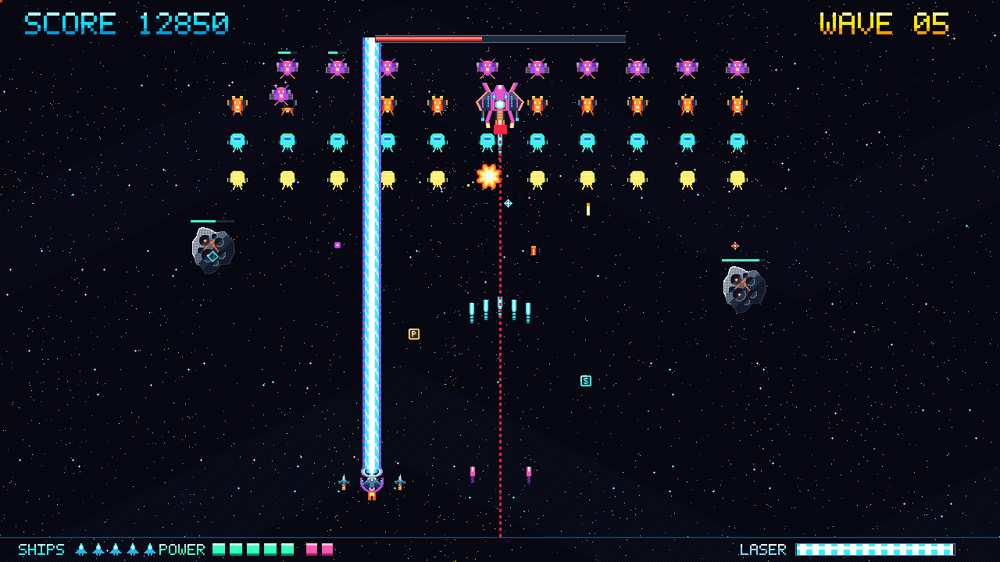
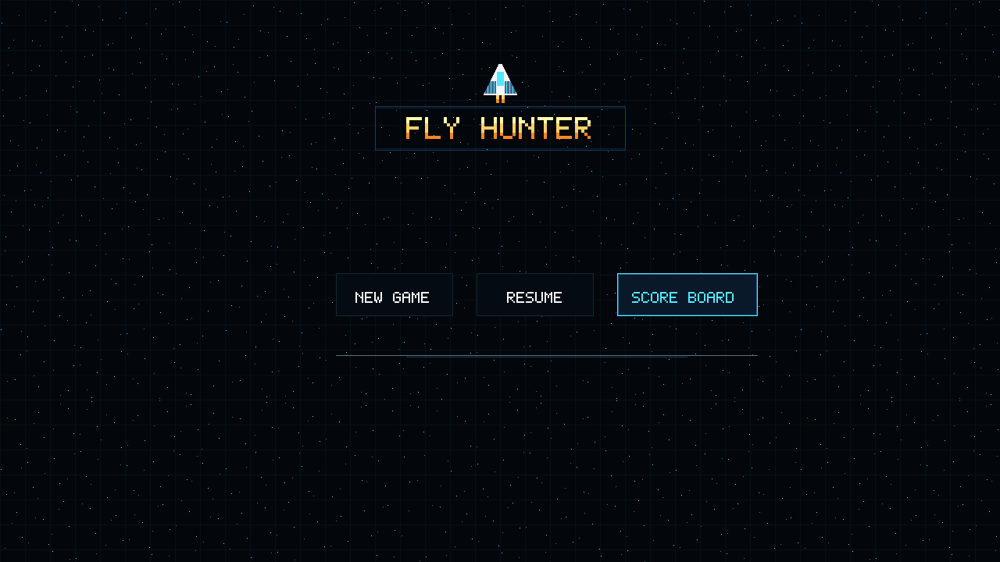
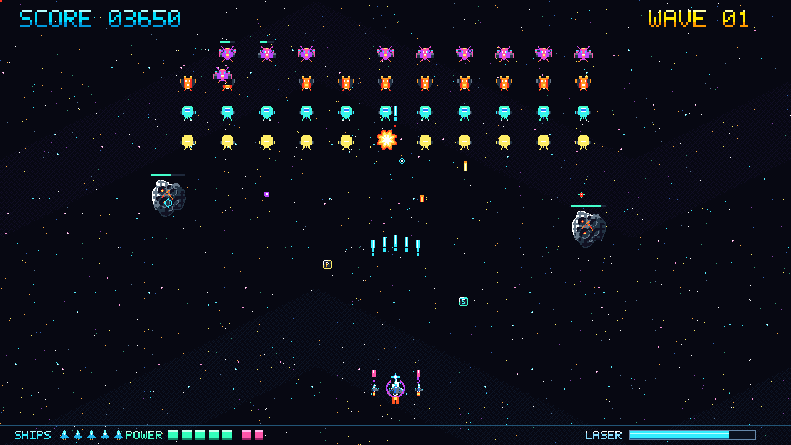
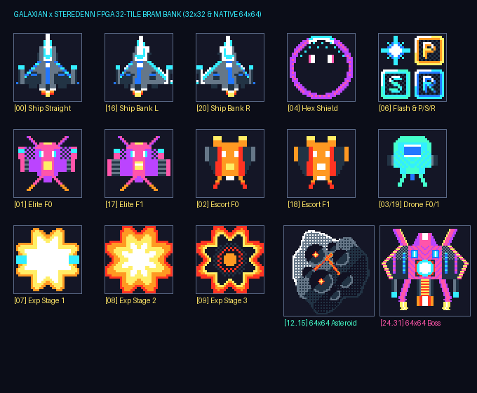
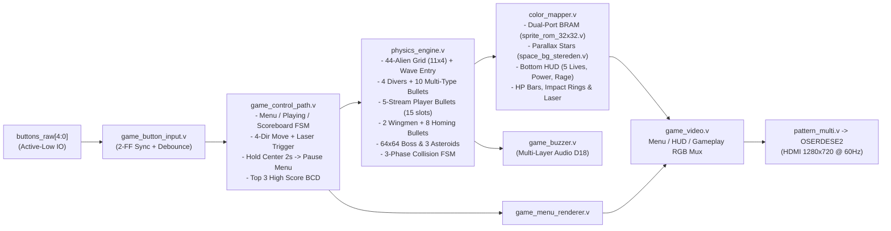
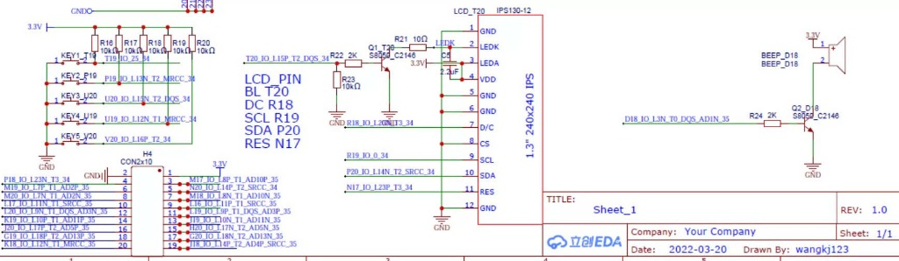
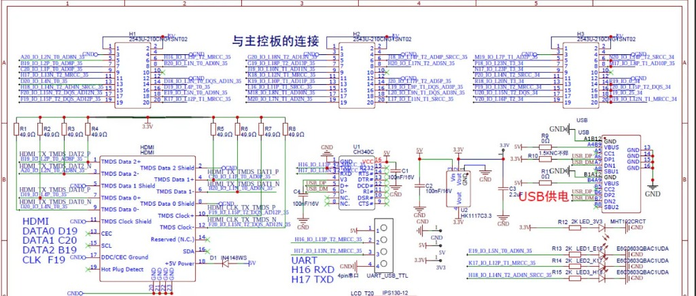

<div align="center">

# 🚀 Galaxian × Steredenn Arcade Shmup — FPGA Hardware Edition

**Thiết kế Phần cứng RTL Toàn diện (Verilog/SystemVerilog) trên SoC Xilinx Zynq-7010 (`xc7z010clg400-1`) — Bo mạch EBAZ4205**

[](https://www.amd.com/)
[](https://github.com/tomorrow56/EBAZ4205_tutorial)
[](https://en.wikipedia.org/wiki/720p)
[-success?style=for-the-badge)](#4-kiến-trúc-phần-cứng-rtl--đóng-timing-720p)
[](#6-hướng-dẫn-mô-phỏng-tổng-hợp--nạp-mạch)

<br/>



*Hình ảnh kết xuất pixel-by-pixel trực tiếp từ phần cứng RTL (`1280×720 @ 60Hz`): Tàu chiến kích hoạt đại pháo **Overdrive Laser**, 2 **Wingmen** phóng đạn tự dẫn, **Khiên năng lượng Tím**, **Thiên thạch `64×64px`** và **Boss Mẫu Hạm** ở trạng thái Cuồng Nộ (`Enrage Mode`) đang bật tia ngắm cảnh báo đỏ.*

</div>

---

## 📋 Mục lục
1. [Giới thiệu Tổng quan](#-1-giới-thiệu-tổng-quan)
2. [Hình ảnh Minh họa Hệ thống (RTL Hardware Renders)](#-2-hình-ảnh-minh-họa-hệ-thống-rtl-hardware-renders)
3. [Tính năng Gameplay & Cơ chế Chiến đấu](#-3-tính-năng-gameplay--cơ-chế-chiến-đấu)
4. [Kiến trúc Phần cứng RTL & Đóng Timing 720p](#-4-kiến-trúc-phần-cứng-rtl--đóng-timing-720p)
5. [Sơ đồ Kết nối Phần cứng Bo mạch EBAZ4205](#-5-sơ-đồ-kết-nối-phần-cứng-bo-mạch-ebaz4205)
6. [Cấu trúc Thư mục Dự án](#-6-cấu-trúc-thư-mục-dự-án)
7. [Hướng dẫn Mô phỏng, Tổng hợp & Nạp Mạch](#-7-hướng-dẫn-mô-phỏng-tổng-hợp--nạp-mạch)
8. [Tài liệu Tham khảo (References)](#-8-tài-liệu-tham-khảo-references)

---

## 🌟 1. Giới thiệu Tổng quan

**`Game_Datapath_V2`** là hệ thống trò chơi bắn súng không gian (**Arcade Shoot 'em up — Shmup**) kết hợp lối chơi đội hình bổ nhào kinh điển của **Namco Galaxian** với hệ thống vũ khí hạng nặng, hiệu ứng hạt và Boss Mẫu Hạm của **Steredenn**.

Toàn bộ cơ chế vật lý, trí tuệ nhân tạo (AI) của 44 quái vật và Boss, bộ kiểm tra va chạm đa pha, bộ kết xuất đồ họa **Dual-Port Block RAM** và bộ tổng hợp âm thanh đa tầng đều được thực thi **100% bằng phần cứng số (Verilog/SystemVerilog RTL)** ở miền xung nhịp Pixel Clock **`74.25 MHz`** (không dùng framebuffer DDR, render có pipeline theo pixel, không lưu toàn bộ frame). Khối xử lý ARM Cortex-A9 (`PS7`) trên Zynq-7010 chỉ đảm nhận việc khởi tạo xung nhịp tham chiếu `100 MHz` và cấu hình thanh ghi chế độ xuất hình HDMI `720p@60Hz` lúc bật nguồn.

| Thông số Kỹ thuật | Giá trị / Chi tiết |
| :--- | :--- |
| **Bo mạch & Chip FPGA** | **EBAZ4205** — SoC **Xilinx Zynq-7010 (`xc7z010clg400-1`)** |
| **Độ phân giải & Tần số quét** | **HDMI 1280×720p @ 60Hz** (`Pixel Clock = 74.25 MHz`, `TMDS Serial Clock = 371.25 MHz`) |
| **Kiến trúc Đồ họa** | Kết xuất trực tiếp theo tia quét (*Scanline Racing*), **Dual-Port BRAM** 32 Tiles `32×32×4-bit` (kèm Sprite `64×64` nguyên bản) |
| **Hệ thống Âm thanh** | Bộ tổng hợp sóng vuông điều chế FM đa tầng ưu tiên phát qua còi Buzzer (`D18`) |
| **Độ dự trữ Thời gian (Timing)** | **`WNS = +0.103 ns`**, **`WHS = +0.028 ns`**, `0 Failing Endpoints` (báo cáo `impl_1` ngày 11/11/2026; cần build lại sau bản vá `game_menu_renderer.v`) |
| **Kiểm chứng Mô phỏng** | **`59/59 PASS`** bài kiểm tra tự động trong `sim/tb_shooter.sv` (Vivado XSim 2024.2) |

---

## 🖼️ 2. Hình ảnh Minh họa Hệ thống (RTL Hardware Renders)

Các hình ảnh dưới đây được trích xuất nguyên bản từng pixel (`1280×720`) từ ngõ ra RGB 24-bit của mạch phần cứng RTL:

| Giao diện Menu & Điều hướng | Chiến đấu Đội hình 44 Quái, Thiên thạch & Vật phẩm |
| :---: | :---: |
|  |  |
| *Giao diện Menu đầu game (`NEW GAME`, `RESUME / CONTINUE`, `SCORE BOARD`) với nền lưới không gian tối.* | *Đội hình 44 quái (`11×4`), 5 tia đạn chính, 2 Wingmen bắn đạn đuổi, Khiên Tím, 2 Thiên thạch `64×64px` kèm thanh máu và vật phẩm `P`, `S`.* |

| Trận chiến Boss Mẫu Hạm & Đại pháo Overdrive Laser | Ngân hàng 32 Sprite Tile `32×32px` & `64×64px` 4-Bit trong Block RAM |
| :---: | :---: |
|  |  |
| *Wave 05: Boss Mẫu Hạm `64×64px` nguyên bản (4 Tile ghép), bật tia ngắm đỏ chuẩn bị phóng Death-Ray đối đầu với cột đại pháo xoắn **Overdrive Laser** của người chơi.* | *32 Tile `32×32px` (16 màu, gồm cả Boss `64×64` và Thiên thạch `64×64` độ phân giải gốc) lưu trong Dual-Port BRAM (`sprite_rom_32x32.v`).* |

---

## 🎮 3. Tính năng Gameplay & Cơ chế Chiến đấu

### 3.1. Điều khiển Tàu & Hệ thống Vũ khí / Phòng thủ
- **Bay 4 hướng tự do (`Lên / Xuống / Trái / Phải`)**: Tàu người chơi di chuyển mượt trong vùng chiến đấu (`X = 32..1216`, `Y = 360..648`) với hiệu ứng nghiêng cánh 3 góc (`Tile 0, 16, 20`) và lửa động cơ phản lực Plasma nhấp nháy.
- **5 Mạng khởi đầu (`PLAYER_INIT_LIVES = 5`, tối đa 5 mạng)**: Hiển thị trực quan bằng 5 huy hiệu tàu màu Cyan dưới thanh HUD đáy màn hình (`SHIPS`).
- **Tự động bắn (`Auto-fire`) bay hết màn hình**:
  - Bộ đệm 15 viên đạn chính (`pbul[0:14]`) được phân hoạch thành **5 luồng × 3 slot riêng biệt mỗi luồng**, tốc độ **`19 px/frame`**, bay xuyên suốt tới sát mép trên màn hình (`Y = 20`) không bao giờ bị biến mất giữa chừng.
  - Nâng cấp súng chính từ **1 tia $\rightarrow$ 2 tia $\rightarrow$ 3 tia $\rightarrow$ 4 tia $\rightarrow$ tối đa 5 tia đạn tỏa góc**.
- **2 Máy bay phụ (`Wingmen`) & Đạn đuổi tự dẫn (`Homing Missiles`)**:
  - Khi đã đạt 5 tia đạn chính, nhặt thêm vật phẩm `P` sẽ mở khóa tối đa **2 Wingmen** bay kèm hai bên cánh, tự động phóng **8 viên đạn đuổi (`hbul[0:7]`)** tự dẫn bám theo tọa độ ngang của mục tiêu.
- **Cơ chế rớt lại vũ khí khi mất mạng**: Khi tàu trúng đạn nổ, người chơi chỉ giảm 1 bậc vũ khí và tàu sẽ **văng lại gói nâng cấp `P` màu vàng** bay ngược lên để có thể nhặt lại ngay.
- **Đại pháo `Overdrive Laser` (Thanh Nộ 20 điểm)**:
  - Tiêu diệt quái vật hoặc nhặt vật phẩm `R` sẽ tích điểm thanh nộ (`LASER` bar ở góc phải dưới).
  - Khi đầy `20/20`, bấm nút Giữa (`KEY3`) sẽ kích hoạt cột đại pháo năng lượng xuyên suốt màn hình trong 2 giây (`120 frames`), quét sạch quái vật, thiên thạch và đạn địch trên đường đi.

### 3.2. Đội hình Quái vật, 4 Loại Đạn Địch & Boss Mẫu Hạm
- **Đội hình 44 Quái vật (`11 cột × 4 hàng`)**:
  - **Hiệu ứng xuất hiện đầu mỗi Wave (`wave_entry_offset`)**: Toàn bộ đội hình quái vật (và Boss) bay mượt từ đỉnh màn hình xuống vị trí dàn trận ở đầu mỗi Wave thay vì xuất hiện đột ngột tại chỗ.
  - **Quái bổ nhào (`4 Divers`)**: Tối đa 4 quái tách đội hình lao xuống tấn công cùng lúc; khi bay hết màn hình dưới sẽ **vòng lại từ đỉnh màn hình (`Y = 16`) đáp xuống vị trí cũ**.
  - Máu quái vật tự động tăng dần theo từng Wave (`Row 0 Elite`, `Row 1 Escort`, `Row 2 Drone`, `Row 3 Gold Drone`).
- **4 Loại đạn quái vật đặc trưng (`ebul_type[1:0]`)**:
  1. **`EBUL_TYPE_FIREBALL` (Cầu lửa Đỏ-Cam)**: Quái Drone hàng 2 & 3 bắn đạn cầu lửa tạo lưới đạn nền.
  2. **`EBUL_TYPE_WAVE` (Đạn xoắn lượn sóng hình chữ S)**: Quái Hộ vệ hàng 1 bắn đạn Tím-Hồng Neon lắc ngang theo quỹ đạo hình sin/chữ S.
  3. **`EBUL_TYPE_SNIPER` (Đạn kim chớp cao tốc)**: Quái Tinh nhuệ hàng 0 & Boss bắn mũi kim Vàng-Trắng lao nhanh gấp `1.6×` nhắm thẳng vào tàu người chơi.
  4. **`EBUL_TYPE_SEEKER` (Cầu gai truy kích)**: Quả cầu gai Xanh Ngọc – Đỏ Thẫm có khả năng tự trôi ngang bám theo tọa độ `ship_x` của người chơi.
- **Boss Mẫu Hạm Khổng Lồ `64×64px` (Mỗi 5 Wave) với 4 Chiêu thức & Chế độ Cuồng Nộ (`Enrage Mode`)**:
  1. **Mưa đạn rẻ quạt 5 hướng (`5-Way Curtain Spread`)**.
  2. **Cặp đạn xoáy kép & Cầu gai truy kích (`Twin Viper + Seeker Salvo`)**.
  3. **Đại pháo hủy diệt có tia ngắm cảnh báo (`Boss Death-Ray + Telegraph Sight`)**: Phát tia laser ngắm cảnh báo nhấp nháy trước khi phóng cột đại pháo rộng 36px kèm rung chấn.
  4. **Chế độ Cuồng Nộ (`Enrage Mode` khi máu < 50%)**: Vỏ giáp Boss rực lửa Đỏ-Vàng, tăng tốc độ di chuyển/bắn đạn và gọi mưa **Thiên thạch khổng lồ `64×64px`** rơi phối hợp.

### 3.3. Vật phẩm (`P / S / R`), Hiệu ứng Hình ảnh (VFX) & Âm thanh
- **3 Gói vật phẩm rơi ra khi bắn hạ quái/thiên thạch**:
  - **Gói `P` (Vàng)**: Nâng cấp tia đạn (`1..5`) và mở khóa Wingmen (`1..2`).
  - **Gói `S` (Xanh Ngọc)**: Hồi `+1` mạng tàu (tối đa 5 mạng) và bật **Khiên năng lượng màu Tím (`Shield`)** trong 2 giây. Khiên sẽ hấp thụ hoàn toàn 1 phát đạn/va chạm rồi vỡ để bảo vệ tàu.
  - **Gói `R` (Xanh Lam)**: Cộng ngay `+6` điểm vào thanh nộ Overdrive Laser.
- **Hiệu ứng va chạm đạn (`Bullet Impact Ring`) & Rung màn hình (`Screen Shake`) không nhòe nhân vật**:
  - Mỗi viên đạn chạm vào quái vật, Boss hoặc thiên thạch đều tạo vòng sóng xung kích lục lam nở rộng kèm hạt tia lửa văng ngược lại.
  - Khi nổ lớn, màn hình rung chấn (`shake_dx`, `shake_dy` chốt mỗi frame 60Hz) nhưng **giữ cố định tọa độ vẽ tàu nhân vật** nên hình ảnh tàu luôn sắc nét tuyệt đối.
- **Menu Tương tác & Bảng xếp hạng Top 3 Điểm cao (`1ST / 2ND / 3RD`)**:
  - Gồm `New Game`, `Resume / Continue` (khi nhấn giữ nút Giữa `KEY3` ~1 giây / 60 frames trong lúc chơi), và `Scoreboard` lưu tự động 3 kỷ lục điểm cao nhất.

---

## ⚙️ 4. Kiến trúc Phần cứng RTL & Đóng Timing 720p

### 4.1. Sơ đồ Khối Kiến trúc Hệ thống



### 4.2. Miền Xung nhịp (Clock Domains) & Tối ưu Đường Găng (Critical Path)
- **`clk_fpga_0` (`100.00 MHz`)**: Cấp từ khối ARM Processing System (`PS7 FCLK_CLK0`) cho giao tiếp AXI-Lite và đầu vào tham chiếu của khối `MMCME2_ADV`.
- **`game_pck_720p` (`74.25 MHz`, chu kỳ `13.468 ns`)**: Miền xung nhịp đồng bộ duy nhất vận hành toàn bộ lõi Game (`physics_engine`, `color_mapper`, `sprite_rom_32x32`, `game_control_path`, `game_buzzer`) và bộ đếm quét hình 720p (`syncgen_multi`).
- **`game_serial_720p` (`371.25 MHz`, chu kỳ `2.694 ns`)**: Xung nhịp tuần tự hóa 5× DDR cho 8 bộ `OSERDESE2` phát tín hiệu vi sai TMDS ra cổng HDMI.
- **4 Kỹ thuật Kiến trúc giúp đạt `WNS = +0.354 ns` ở `74.25 MHz`:**
  1. **Tiền giải mã cột X (`col_vis_rows[3:0]`)** song song với bộ so sánh hàng Y trong `color_mapper.v`, rút ngắn đường địa chỉ Dual-Port BRAM Port A xuống chỉ còn 6 tầng logic.
  2. **FSM Kiểm tra Va chạm Tuần tự 3 Pha (`c_phase = 0, 1, 2`)** trong `physics_engine.v`: Tách bước đọc tọa độ đạn (`Fetch`), bước phát hiện va chạm (`Hit Detect`) và bước cập nhật máu/VFX (`Damage & VFX`) thành 3 chu kỳ xung nhịp riêng biệt.
  3. **Bộ cộng điểm BCD 5 chữ số (`bcd_add`)** qua thanh ghi đệm `pending_pts`, loại bỏ hoàn toàn các mạch chia thập phân `/ 10`, `% 10`.
  4. **Chốt tọa độ Rung màn hình (`shake_dx`, `shake_dy`)** tại xung `frame_tick` đầu mỗi khung hình 60Hz.

### 4.3. Ngân hàng 32 Sprite Tile `32×32` 4-Bit trong Dual-Port Block RAM (`sprite_rom_32x32.v`)
Mỗi Tile có kích thước chuẩn **`32 × 32 = 1.024 pixels`** ($2^5 \times 2^5$), tổng cộng **`32 × 1.024 = 32.768 words × 4-bit`**, giúp phép tính địa chỉ trong phần cứng chỉ là phép ghép bit `{tile_id[4:0], dy[4:0], dx[4:0]}` mà không tốn bộ nhân hay mạch cộng:

| `tile_id` | Địa chỉ BRAM | Đối tượng Hiển thị | Kích thước Hiển thị trên Màn hình |
| :---: | :---: | :--- | :--- |
| **`0, 16, 20`** | `0..1023`, `16384..17407`, `20480..21503` | **Tàu người chơi** (Bay thẳng, Nghiêng Trái 3D, Nghiêng Phải 3D) | `32×32 px` (và `16×16 px` cho 2 Wingmen bằng `dx<<1, dy<<1`) |
| **`1, 17, 21`** | `1024..2047`, `17408..18431`, `21504..22527` | **Quái Hàng 0 Tinh nhuệ (`Row 0 Elite`) — Hoạt ảnh 4 frame mượt mà** | `32×32 px` (Chu kỳ vỗ cánh & chớp sừng năng lượng: `F0 -> F1 -> F2 -> F1`) |
| **`2, 18, 22`** | `2048..3071`, `18432..19455`, `22528..23551` | **Quái Hàng 1 Hộ vệ (`Row 1 Escort`) — Hoạt ảnh 4 frame mượt mà** | `32×32 px` (Chu kỳ quét chém lưỡi dao Scythe & quét đèn visor: `F0 -> F1 -> F2 -> F1`) |
| **`3, 19, 23`** | `3072..4095`, `19456..20479`, `23552..24575` | **Quái Hàng 2 & 3 (`Row 2/3 Drone`) — Hoạt ảnh 4 frame mượt mà** | `32×32 px` (Xúc tu máy co duỗi & nạp nòng súng; Hàng 3 tự động đổi sang Giáp Vàng) |
| **`4`** | `4096 .. 5119` | **Vòng Khiên Năng lượng Lục giác (`Hex Energy Shield`)** | `32×32 px` bao quanh tàu người chơi khi `invuln_timer > 0` |
| **`6`** | `6144 .. 7167` | **Chớp lửa đầu nòng & 3 Viên nang Vật phẩm `[P]`, `[S]`, `[R]`** | 4 Sub-tile `16×16 px` riêng biệt cho Muzzle Flash, `[P]`, `[S]`, `[R]` |
| **`7 .. 10`** | `7168 .. 11263` | **Chuỗi Vụ nổ 4 Giai đoạn (`4-Stage Explosion`)** | `32×32 px` (Chớp lõi trắng $\rightarrow$ Cầu lửa $\rightarrow$ Sóng xung kích $\rightarrow$ Khói tàn) |
| **`11`** | `11264 .. 12287` | **Vòng xung kích Đại pháo (`Overdrive Laser Shockwave`)** | `32×32 px` tại đầu mũi tàu khi đang phóng đại pháo Laser |
| **`12 .. 15`** | `12288 .. 16383` | **Thiên thạch Hố va chạm & Nham thạch (`Native 64×64 Asteroid`)** | **`64×64 px` độ phân giải gốc** (`{3'b011, ady[5], adx[5], ady[4:0], adx[4:0]}`) |
| **`24 .. 27`** | `24576 .. 28671` | **Boss Mẫu Hạm Dreadnought — Frame 0 (`Native 64×64 Boss F0`)** | **`64×64 px` độ phân giải gốc** (`{3'b110, bdy[5], bdx[5], bdy[4:0], bdx[4:0]}`) |
| **`28 .. 31`** | `28672 .. 32767` | **Boss Mẫu Hạm Dreadnought — Frame 1 (`Native 64×64 Boss F1`)** | **`64×64 px` độ phân giải gốc** (Lõi phản vật chất đập & Càng kẹp chuyển động) |

---

## 🔌 5. Sơ đồ Kết nối Phần cứng Bo mạch EBAZ4205

### 5.1. Sơ đồ Nguyên lý Bo mạch Mở rộng (Extension Board Schematics)

| Sơ đồ 5 Nút bấm, Còi Buzzer (`D18`) & Màn hình phụ | Sơ đồ Cổng HDMI (`TMDS_33`), UART Type-C & Đèn LED |
| :---: | :---: |
|  |  |

### 5.2. Bảng Phân bố Chân Tín hiệu FPGA (Pinout Mapping)

#### 🎮 5 Nút nhấn điều khiển (Pushbuttons — Active-Low `LVCMOS33`)
| Tên nút trên mạch | Bit `buttons_raw` | Chân FPGA | Chức năng trong Menu | Chức năng khi đang chơi (`PLAYING`) |
| :--- | :---: | :---: | :--- | :--- |
| **KEY1 (Right)** | `buttons_raw[0]` | `T19` | — | **Bay sang Phải** (`move_right`) |
| **KEY2 (Up)** | `buttons_raw[1]` | `P19` | **Di chuyển Lên** | **Bay Lên trên** (`move_up`) |
| **KEY3 (Center)** | `buttons_raw[2]` | `U20` | **Chọn mục Menu** / Thoát bảng điểm | • **Bấm & nhả nhanh (< 60 frames ~ 1 giây)**: Khai hỏa **Overdrive Laser** (khi thanh nộ đầy 20/20)<br>• **Nhấn giữ ≥ 60 frames (~1 giây)**: Tạm dừng về Menu (**Resume**) |
| **KEY4 (Left)** | `buttons_raw[3]` | `U19` | — | **Bay sang Trái** (`move_left`) |
| **KEY5 (Down)** | `buttons_raw[4]` | `V20` | **Di chuyển Xuống** | **Bay Xuống dưới** (`move_down`) |

#### 📺 Cổng Xuất hình HDMI (`TMDS_33`), Âm thanh Buzzer (`D18`), LED & UART
| Khối chức năng | Tín hiệu | Chân FPGA | Chuẩn IO | Ghi chú |
| :--- | :--- | :---: | :---: | :--- |
| **HDMI 720p@60Hz** | `HDMI_CLK_P / N` | `F19 / F20` | `TMDS_33` | Pixel Clock vi sai `74.25 MHz` |
| **HDMI 720p@60Hz** | `HDMI_D0_P / N` | `D19 / D20` | `TMDS_33` | Kênh Blue / HSync / VSync |
| **HDMI 720p@60Hz** | `HDMI_D1_P / N` | `C20 / B20` | `TMDS_33` | Kênh Green |
| **HDMI 720p@60Hz** | `HDMI_D2_P / N` | `B19 / A20` | `TMDS_33` | Kênh Red |
| **Âm thanh Buzzer** | `buzzer_out` (`BEEP`) | `D18` | `LVCMOS33` | Điều chế âm thanh đa tầng qua transistor Q2 S8050 |
| **Đèn LED trạng thái** | `LED1 / LED2 / LED3` | `E19 / K17 / H18` | `LVCMOS33` | Tùy chọn phần cứng (chưa nối ra top-level `pattern_multi` / XDC hiện tại) |
| **UART Type-C** | `UART_0_rxd / txd` | `H16 / H17` | `LVCMOS33` | Giao tiếp log khởi tạo từ ARM PS7 (`115200 baud`) |

---

## 📊 6. Báo cáo Tiêu thụ Tài nguyên Kit & Timing Closure

Dự án được tối ưu hóa sâu ở mức kiến trúc RTL (gom bảng màu Palette tập trung, FSM va chạm 3 pha chia nhỏ combinational path, khử phép nhân bằng phép dịch bit, pipeline đạn/divers, cách ly thứ bậc `keep_hierarchy`). Kết quả tổng hợp và thực thi (Place & Route) thực tế trên chip **AMD/Xilinx Zynq-7010 (`xc7z010clg400-1`)**:

> **Phạm vi số liệu:** Các bảng tài nguyên/timing dưới đây lấy từ `Game_Datapath_V2.runs/impl_1/system_wrapper_utilization_placed.rpt` và `system_wrapper_timing_summary_routed.rpt` ngày 14/11/2026 (đã đồng bộ với `system_wrapper.bit` và `BOOT.BIN`).

### 6.1. Bảng Sử dụng Tài nguyên Logic & Bộ nhớ (Placed Utilization)

| Loại tài nguyên phần cứng (Resource) | Đã sử dụng (Used) | Tổng dung lượng kit (Available) | Tỷ lệ sử dụng (%) | Ghi chú & Tối ưu hóa |
| :--- | :---: | :---: | :---: | :--- |
| **Slice LUTs** | **14,902** | 17,600 | **84.67%** | Báo cáo placed ngày 14/11/2026 |
| **Slice Registers (Flip-Flops)** | **3,716** | 35,200 | **10.56%** | Báo cáo placed ngày 14/11/2026 |
| **Total Slices** | **4,346** | 4,400 | **98.77%** | Báo cáo placed ngày 14/11/2026 |
| **Block RAM (BRAM Tile RAMB36)** | **4** | 60 | **6.67%** | ROM 32 tile × 32×32 × 4-bit |
| **DSP48E1 Slices** | **2** | 80 | **2.50%** | Điều chế sóng âm còi Buzzer; hitbox & render dùng 0 DSP (toàn bộ dùng shift-and-add) |
| **Khối MMCM (`MMCME2_ADV`)** | **1** | 2 | **50.00%** | Khóa xung nhịp kép 74.25 MHz (Pixel) và 371.25 MHz (Serial 5×) |
| **Bộ tuần tự hóa `OSERDESE2`** | **8** | 64 | **12.50%** | 4 kênh TMDS DDR 10:1 xuất hình trực tiếp ra cổng HDMI |

### 6.2. Kết quả Đóng gói Thời gian thực (Timing Closure @ 720p 60FPS)

Báo cáo routed ngày 14/11/2026 ghi nhận các kết quả sau:
- **Tần số Pixel Clock thực tế**: `74.25 MHz` (chu kỳ `13.468 ns`)
- **Tần số Serial TMDS Clock**: `371.25 MHz` (chu kỳ `2.694 ns`)
- **Worst Negative Slack (WNS)**: `+0.084 ns` (Dương – đạt chuẩn Timing Closure)
- **Worst Hold Slack (WHS)**: `+0.054 ns` (Dương)
- **Worst Pulse Width Slack (WPWS)**: `+0.538 ns`
- **Failing Endpoints**: **`0 / 0 / 0`** (100% đường truyền đạt chuẩn)

---

## 📂 7. Cấu trúc Thư mục Dự án

```text
Game_Datapath_V2/
├── rtl/
│   ├── game/
│   │   ├── game_params.vh            # Hằng số cấu hình 720p, tốc độ đạn, 5 mạng, mã vật phẩm & đạn địch
│   │   ├── palette_lut.vh            # Bảng màu 16-color RGB 24-bit cho các Sprite ngân hàng BRAM
│   │   ├── physics_engine.v          # Engine vật lý, AI quái/Boss, đạn, vật phẩm & FSM va chạm 3 pha
│   │   ├── color_mapper.v            # Bộ kết xuất đồ họa pixel-by-pixel, HUD, HP bar & hiệu ứng VFX
│   │   ├── sprite_rom_32x32.v        # Dual-Port Block RAM chứa 32 Tile 32x32x4-bit (sprites_32x32.mem)
│   │   ├── space_bg_stereden.v       # Nền vũ trụ tối kèm 3 tầng sao Parallax trôi mượt
│   │   ├── game_hud.v                # Hiển thị điểm số BCD 5 chữ số, Wave, Game Over & Top 3 High Score
│   │   ├── game_menu_renderer.v      # Giao diện Menu đầu game (New Game / Resume / Scoreboard)
│   │   ├── game_control_path.v       # FSM điều khiển trạng thái Menu/Playing, lưu Top 3 điểm & giữ nút 2s
│   │   ├── game_button_input.v       # Đồng bộ CDC 2-FF & chống dội phím (Debounce) cho 5 nút nhấn
│   │   ├── game_buzzer.v             # Bộ tổng hợp âm thanh đa tầng phát qua chân Buzzer D18
│   │   ├── font_rom.v                # ROM phông chữ cho Menu và HUD
│   │   ├── datapath.v                # Kết nối Physics Engine <-> Color Mapper <-> HUD <-> Starfield
│   │   └── game_core.v               # Đóng gói toàn bộ lõi Game + Control Path + Audio Buzzer
│   └── video/
│       ├── game_clock_reset.v        # Đồng bộ Reset & kiểm tra khóa xung nhịp 720p
│       ├── frame_tick.v              # Tạo xung nhịp frame_tick (1 chu kỳ PCK ở đầu mỗi khung hình 60Hz)
│       ├── game_video.v              # Kết nối game_core, Menu, HUD với bộ đếm quét hình HDMI 720p
│       └── pattern_multi.v           # Tầng tích hợp Video + bộ tạo xung đồng bộ syncgen_multi
├── constraints/                      # File ràng buộc chân phần cứng XDC và timing 720p
├── sim/
│   └── tb_shooter.sv                 # Testbench tự động kiểm tra toàn diện 59 hạng mục gameplay & đồ họa
├── scripts/
│   ├── build_all_v2.tcl              # Script tổng hợp OOC -> Full Synth -> Place & Route -> Bitstream & XSA
│   ├── program_jtag.tcl              # Script XSDB nạp Bitstream + khởi tạo ARM PS7 + chạy ELF qua JTAG
│   └── ...                           # Các script kiểm tra timing 720p và hỗ trợ mô phỏng
├── vitis_game_v2/                    # Workspace Vitis chứa FSBL (fsbl.elf) và ứng dụng ARM (hdmi_game_app_v2.elf)
├── docs/
│   ├── hardware/                     # Sơ đồ nguyên lý bo mạch mở rộng EBAZ4205
│   └── images/                       # Hình ảnh chụp màn hình 1280x720 kết xuất trực tiếp từ RTL
├── boot.bif                          # Cấu hình đóng gói Bootgen tương đối (fsbl.elf + bitstream + app.elf)
├── BOOT.BIN                          # File ảnh khởi động tự động hoàn chỉnh (dùng cho Thẻ nhớ MicroSD / Flash)
├── CHAY_GAME_JTAG.bat                # Chạy nhanh game qua cáp JTAG chỉ bằng 1 cú nhấp đúp chuột
└── NAP_NAND_FLASH_KHONG_CAN_THE_NHO.bat # Script nạp BOOT.BIN vào NAND Flash
```

---

## 🚀 8. Hướng dẫn Mô phỏng, Tổng hợp & Nạp Mạch

> **Asset ROM:** Nguồn chính là `rtl/game/sprites_32x32.mem`. Vivado đã đăng ký file này trong `sources_1`; script shooter/video copy nó vào thư mục chạy trước khi mô phỏng. `$readmemh` dùng tên file tương đối. Khi đổi máy, cần kiểm tra đường dẫn toolchain (tham số `-VivadoBin`) và workspace Vitis; chưa kiểm chứng khả chuyển của toàn bộ quy trình boot.

### 8.1. Chạy mô phỏng kiểm thử RTL (`sim/tb_shooter.sv` — 59 kiểm tra tự động)
Mở PowerShell tại thư mục gốc của dự án và chạy script tự động:
```powershell
powershell -ExecutionPolicy Bypass -File scripts/run_shooter_sim.ps1
```
Hoặc chạy thủ công từng bước với Vivado:
```powershell
$files = (Get-ChildItem rtl/game/*.v, sim/tb_shooter.sv).FullName
Copy-Item rtl/game/sprites_32x32.mem . -Force
xvlog --sv -i rtl/game $files
xelab tb_shooter -s tb_shooter_sim
xsim tb_shooter_sim -R
```
Kết quả mong đợi:
```text
PASS: tb_shooter all 59 verification checks succeeded!
```

Để kiểm tra đồng bộ video quét hình HDMI 720p 60Hz 2 frame đầy đủ:
```powershell
powershell -ExecutionPolicy Bypass -File scripts/run_video_sim.ps1
```

Bộ shooter gồm 32 kiểm tra cũ và 27 kiểm tra bổ sung cho hai pickup đồng thời: nâng cấp súng/wingman, giới hạn mạng/rage và cộng điểm BCD. Pickup xử lý theo thứ tự slot 0 rồi slot 1, thêm một chu kỳ pixel clock vào lượt collision. High score chỉ lưu trong thanh ghi và bị xóa khi reset.

### 8.1.1. Kiến trúc Độc lập 100% Phần cứng (Pure RTL Hardware)

Toàn bộ hệ thống trò chơi vận hành trực tiếp trên chip FPGA Xilinx Zynq-7010 (kit EBAZ4205), không phụ thuộc vào PC hay bất kỳ phần mềm mô phỏng nào. Tất cả logic game từ vật lý, kiểm tra va chạm, âm thanh còi buzzer cho đến bộ kết xuất HDMI 720p 60Hz đều do các khối phần cứng số RTL đảm nhiệm. Khối ARM Cortex-A9 chỉ khởi tạo xung nhịp ban đầu lúc bật nguồn.

Kiểm chứng bản sửa pickup ngày 10/11/2026 (Vivado/XSim 2024.2): shooter **59/59 PASS**, video unit **110 kiểm tra PASS**, video integration **1.522 kiểm tra PASS / 2 frame 720p**. Synthesis riêng `game_core` từ bản sao ở thư mục khác thành công, đọc ROM tương đối và suy diễn **4 BRAM**; có warning, không có critical warning/error. Chưa chạy lại place-and-route toàn hệ thống hoặc kiểm tra trên board cho bản sửa này.

### 8.2. Tổng hợp lại Bitstream và tạo file `BOOT.BIN`
```powershell
vivado -mode batch -source scripts/build_all_v2.tcl
bootgen -image boot.bif -arch zynq -o BOOT.BIN -w on
```

### 8.3. Nạp chạy trực tiếp qua cáp JTAG (1-Click)
Khi cắm cáp JTAG vào máy tính, nhấp đúp vào file `CHAY_GAME_JTAG.bat` (hoặc chạy lệnh):
```powershell
xsdb scripts/program_jtag.tcl
```
> **Lưu ý:** Không chỉ bấm riêng nút *Program Device* trong Vivado Hardware Manager sau khi rút nguồn, vì khối FPGA trên Zynq-7010 cần nhân ARM Cortex-A9 chạy `ps7_init` và `hdmi_game_app_v2.elf` để cấp xung nhịp `100 MHz` và bật chế độ HDMI 720p. File `CHAY_GAME_JTAG.bat` thực hiện tự động toàn bộ quy trình này.

### 8.4. Chạy tự động mỗi khi cấp nguồn (SD Card Boot — Không cần máy tính)
Bo mạch EBAZ4205 của dự án được cấu hình ở chế độ **SD Boot (`BOOT_MODE = 0x00000005`)**:
1. Chuẩn bị 1 thẻ nhớ **MicroSD** định dạng **FAT32**.
2. Copy file `BOOT.BIN` ở thư mục gốc dự án vào thư mục gốc của thẻ nhớ.
3. Cắm thẻ nhớ vào khe MicroSD trên bo EBAZ4205. Mỗi khi cấp nguồn, mạch sẽ tự động nạp cả FPGA Bitstream lẫn phần mềm ARM từ thẻ nhớ và khởi động thẳng vào game sau ~1 giây.

---

## 📚 9. Tài liệu Tham khảo (References)

1. **Bo mạch & Phần cứng mở rộng EBAZ4205:**
   - [EBAZ4205 Tutorial & Extension Board Schematics — tomorrow56 (GitHub)](https://github.com/tomorrow56/EBAZ4205_tutorial.git): Tài liệu tham khảo gốc về sơ đồ chân bo mạch điều khiển EBAZ4205, mạch mở rộng HDMI, 5 nút nhấn, còi Buzzer và khối tạo xung nhịp video `MMCME2_ADV` / `OSERDESE2`.
2. **Tài liệu Kỹ thuật Xilinx / AMD Zynq-7000 SoC:**
   - *AMD/Xilinx UG585 — Zynq-7000 SoC Technical Reference Manual*: Khởi tạo hệ thống PS7, cấu hình thanh ghi `BOOT_MODE`, bộ điều khiển xung nhịp FCLK và giao tiếp AXI.
   - *AMD/Xilinx UG472 — 7 Series FPGAs Clocking Resources*: Cấu hình bộ nhân/chia tần số động DRP cho `MMCME2_ADV` tạo Pixel Clock `74.25 MHz` và Serial Clock `371.25 MHz`.
   - *AMD/Xilinx UG471 — 7 Series FPGAs SelectIO Resources*: Chuẩn giao tiếp vi sai `TMDS_33` và bộ tuần tự hóa `OSERDESE2` 10:1 DDR cho chuẩn video số HDMI/DVI.
   - *AMD/Xilinx UG473 — 7 Series FPGAs Memory Resources*: Thiết kế bộ nhớ Dual-Port Block RAM (`RAMB18E1`) lưu trữ ngân hàng Sprite phần cứng.
3. **Chuẩn Hiển thị Video & Thiết kế Game Arcade:**
   - *CEA-861-D / VESA HDTV 1280×720p @ 60Hz Timing Standard*: Chuẩn quét hình 720p (`H_ACTIVE = 1280`, `H_TOTAL = 1650`, `V_ACTIVE = 720`, `V_TOTAL = 750`, `Pixel Clock = 74.25 MHz`).
   - Cảm hứng cơ chế gameplay và phong cách đồ họa: *Namco Galaxian (1979)* (đội hình quái vật bổ nhào chiến thuật) kết hợp cùng *Pixelnest Studio Steredenn* (vũ khí đa dạng, hiệu ứng đạn phần cứng, thiên thạch, đại pháo Laser và Boss Mẫu Hạm).
