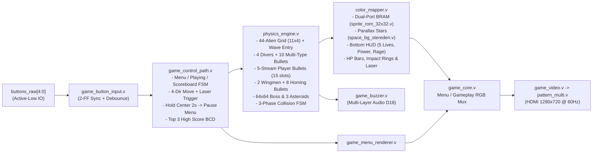

# Game_Datapath_V2 — Galaxian × Steredenn Arcade Shmup (FPGA Zynq-7010 HDMI 720p@60Hz)

Dự án game bắn súng không gian **Galaxian × Steredenn Arcade Shmup** được thiết kế hoàn toàn bằng phần cứng RTL (Verilog/SystemVerilog) trên bo mạch **EBAZ4205** (chip SoC **Xilinx Zynq-7010 `xc7z010clg400-1`**), xuất hình ảnh độ phân giải **HDMI 1280×720 @ 60Hz** (`PCK = 74.25 MHz`, `SerialClk = 371.25 MHz`) và âm thanh đa tầng qua còi Buzzer (`D18`).

---

## 1. Tổng quan Dự án & Tính năng Nổi bật

### 1.1. Điều khiển Tàu & Hệ thống Vũ khí / Phòng thủ
- **Bay 4 hướng tự do (`Lên / Xuống / Trái / Phải`)**: Tàu người chơi di chuyển mượt trong vùng chiến đấu (`X = 160..1088`, `Y = 360..648`) với hiệu ứng nghiêng cánh (`ship_tilt_frame`) và lửa động cơ phản lực Plasma nhấp nháy.
- **5 Mạng khởi đầu (`PLAYER_INIT_LIVES = 5`, tối đa 5 mạng)**: Hiển thị trực quan bằng 5 huy hiệu tàu màu Cyan dưới thanh HUD đáy màn hình.
- **Tự động bắn (`Auto-fire`) bay hết màn hình**:
  - Bộ đệm 15 viên đạn chính (`pbul[0:14]`) được phân hoạch thành **5 luồng × 3 slot riêng biệt mỗi luồng**, tốc độ **`19 px/frame`**, bay xuyên suốt tới sát mép trên màn hình (`Y = 20`) không bao giờ bị biến mất giữa chừng.
  - Nâng cấp súng chính từ **1 tia $\rightarrow$ 2 tia $\rightarrow$ 3 tia $\rightarrow$ 4 tia $\rightarrow$ tối đa 5 tia đạn tỏa góc**.
- **2 Máy bay phụ (`Wingmen`) & Đạn đuổi tự dẫn (`Homing Missiles`)**:
  - Khi đã đạt 5 tia đạn chính, nhặt thêm vật phẩm `P` sẽ mở khóa tối đa **2 Wingmen** bay kèm hai bên cánh, tự động phóng **8 viên đạn đuổi (`hbul[0:7]`)** tự dẫn bám theo tọa độ ngang của mục tiêu.
- **Cơ chế rớt lại vũ khí khi mất mạng**: Khi tàu trúng đạn nổ, người chơi chỉ giảm 1 bậc vũ khí và tàu sẽ **văng lại gói nâng cấp `P` màu vàng** bay ngược lên để có thể nhặt lại ngay.
- **Đại pháo `Overdrive Laser` (Thanh Nộ 20 điểm)**:
  - Tiêu diệt quái vật hoặc nhặt vật phẩm `R` sẽ tích điểm thanh nộ (`rage_cnt`).
  - Khi đầy `20/20`, bấm nút Giữa (`KEY3`) sẽ kích hoạt cột đại pháo năng lượng xuyên suốt màn hình trong 2 giây (`120 frames`), quét sạch quái vật, thiên thạch và đạn địch trên đường đi.

### 1.2. Đội hình Quái vật, 4 Loại Đạn Địch & Boss Mẫu Hạm
- **Đội hình 44 Quái vật (`11 cột × 4 hàng`)**:
  - **Hiệu ứng xuất hiện đầu mỗi Wave (`wave_entry_offset`)**: Toàn bộ đội hình quái vật (và Boss) bay mượt từ đỉnh màn hình xuống vị trí dàn trận ở đầu mỗi Wave thay vì xuất hiện đột ngột tại chỗ.
  - **Quái bổ nhào (`4 Divers`)**: Tối đa 4 quái tách đội hình lao xuống tấn công cùng lúc; khi bay hết màn hình dưới sẽ **vòng lại từ đỉnh màn hình (`Y = 16`) đáp xuống vị trí cũ**.
  - Máu quái vật tự động tăng dần theo từng Wave (`Row 0 Elite`, `Row 1 Escort`, `Row 2 Drone`, `Row 3 Gold Drone`).
- **4 Loại đạn quái vật đặc trưng (`ebul_type[1:0]`)**:
  1. **`EBUL_TYPE_FIREBALL` (Cầu lửa Đỏ-Cam)**: Quái Drone hàng 2 & 3 bắn đạn cầu lửa tạo lưới đạn nền.
  2. **`EBUL_TYPE_WAVE` (Đạn xoắn lượn sóng hình chữ S)**: Quái Hộ vệ hàng 1 bắn đạn Tím-Hồng Neon lắc ngang theo quỹ đạo hình sin/chữ S.
  3. **`EBUL_TYPE_SNIPER` (Đạn kim chớp cao tốc)**: Quái Tinh nhuệ hàng 0 & Boss bắn mũi kim Vàng-Trắng lao nhanh gấp `1.6×` nhắm thẳng vào tàu người chơi.
  4. **`EBUL_TYPE_SEEKER` (Cầu gai truy kích)**: Quả cầu gai Xanh Ngọc – Đỏ Thẫm có khả năng tự trôi ngang bám theo tọa độ `ship_x` của người chơi.
- **Boss Mẫu Hạm Khổng Lồ `64×64px` (Mỗi 5 Wave) với 4 Chiêu thức & Chế độ Cuồng Nộ (`Enrage Mode`)**:
  1. **Mưa đạn rẻ quạt 5 hướng (`5-Way Curtain Spread`)**.
  2. **Cặp đạn xoáy kép & Cầu gai truy kích (`Twin Viper + Seeker Salvo`)**.
  3. **Đại pháo hủy diệt có tia ngắm cảnh báo (`Boss Death-Ray + Telegraph Sight`)**: Phát tia laser ngắm cảnh báo nhấp nháy trước khi phóng cột đại pháo rộng 36px kèm rung chấn.
  4. **Chế độ Cuồng Nộ (`Enrage Mode` khi máu < 50%)**: Vỏ giáp Boss rực lửa Đỏ-Vàng, tăng tốc độ di chuyển/bắn đạn và gọi mưa **Thiên thạch khổng lồ `64×64px`** rơi phối hợp.

### 1.3. Vật phẩm (`P / S / R`), Hiệu ứng Hình ảnh (VFX) & Âm thanh
- **3 Gói vật phẩm rơi ra khi bắn hạ quái/thiên thạch**:
  - **Gói `P` (Vàng)**: Nâng cấp tia đạn (`1..5`) và mở khóa Wingmen (`1..2`).
  - **Gói `S` (Xanh Ngọc)**: Hồi `+1` mạng tàu (tối đa 5 mạng) và bật **Khiên năng lượng màu Tím (`Shield`)** trong 2 giây. Khiên sẽ hấp thụ hoàn toàn 1 phát đạn/va chạm rồi vỡ để bảo vệ tàu.
  - **Gói `R` (Xanh Lam)**: Cộng ngay `+6` điểm vào thanh nộ Overdrive Laser.
- **Hiệu ứng va chạm đạn (`Bullet Impact Ring`) & Rung màn hình (`Screen Shake`) không nhòe nhân vật**:
  - Mỗi viên đạn chạm vào quái vật, Boss hoặc thiên thạch đều tạo vòng sóng xung kích lục lam nở rộng kèm hạt tia lửa văng ngược lại.
  - Khi nổ lớn, màn hình rung chấn (`shake_dx`, `shake_dy` chốt mỗi frame 60Hz) nhưng **giữ cố định tọa độ vẽ tàu nhân vật** nên hình ảnh tàu luôn sắc nét tuyệt đối.
- **Menu Tương tác & Bảng xếp hạng Top 3 Điểm cao (`1ST / 2ND / 3RD`)**:
  - Gồm `New Game`, `Continue` (khi nhấn giữ nút Giữa `KEY3` 2 giây trong lúc chơi), và `Scoreboard` lưu tự động 3 kỷ lục điểm cao nhất.

---

## 2. Kiến trúc Phần cứng RTL & Miền Xung nhịp

### 2.1. Sơ đồ khối Kiến trúc Tổng thể



### 2.2. Miền Xung nhịp (Clock Domain) & Đóng Timing 720p
- **`clk_fpga_0` (`100.00 MHz`)**: Xuất phát từ khối ARM Processing System (`PS7 FCLK_CLK0`), cấp xung cho bus AXI-Lite và đầu vào tham chiếu của `MMCME2_ADV`.
- **`game_pck_720p` (`74.25 MHz`, `13.468 ns`)**: Miền xung nhịp duy nhất vận hành toàn bộ lõi Game (`physics_engine`, `color_mapper`, `sprite_rom_32x32`, `game_control_path`, `game_buzzer`) và bộ quét hình 720p (`syncgen_multi`).
- **`game_serial_720p` (`371.25 MHz`, `2.694 ns`)**: Xung nhịp tuần tự hóa 5× DDR cho 8 khối `OSERDESE2` phát tín hiệu vi sai TMDS ra cổng HDMI.
- **`frame_tick`**: Xung Clock Enable rộng đúng 1 chu kỳ `PCK` tại đầu mỗi khung hình 60Hz (`HCNT == 0, VCNT == 0`).
- **Kết quả đóng Timing sau định tuyến (Post-Route Timing Summary):**
  - **Setup Slack (`WNS`)**: **`+0.473 ns`** (`TNS = 0.000 ns`, 0 vi phạm)
  - **Hold Slack (`WHS`)**: **`+0.063 ns`** (`THS = 0.000 ns`, 0 vi phạm)
- **Các kỹ thuật tối ưu đường găng (Critical Path):**
  1. **Tiền giải mã cột X (`col_vis_rows`)** song song với bộ so sánh hàng Y trong `color_mapper.v` để rút ngắn đường địa chỉ Dual-Port BRAM.
  2. **FSM Va chạm Tuần tự 3 Pha (`c_phase = 0, 1, 2`)** trong `physics_engine.v` tách biệt bước đọc tọa độ đạn, kiểm tra va chạm và cập nhật sát thương/VFX.
  3. **Bộ cộng điểm BCD 5 chữ số (`bcd_add`)** qua thanh ghi đệm `pending_pts`, loại bỏ phép chia thập phân `/ 10`, `% 10`.
  4. **Chốt độ lệch rung màn hình (`shake_dx`, `shake_dy`)** theo `frame_tick`.

### 2.3. Ngân hàng 12 Sprite Tile `32×32` 4-Bit trong Dual-Port Block RAM (`sprite_rom_32x32.v`)
Khối `RAMB18E1` lưu trữ `12.288 × 4-bit` (12 Tile `32×32px`, bảng màu 16 màu RGB 24-bit trong `palette_lut.vh`), khởi tạo từ `rtl/game/steredenn_enemy_bank.hex`:
- **`Tile 0, 9, 10`**: Tàu người chơi (Bay thẳng, Nghiêng trái, Nghiêng phải `32×32px`) và 2 Wingmen (`16×16px`).
- **`Tile 1`**: Quái Hàng 0 Tinh nhuệ (`32×32px`) & Boss Mẫu Hạm (`64×64px` phóng đại 2×).
- **`Tile 2`**: Quái Hàng 1 Hộ vệ (`32×32px`).
- **`Tile 3`**: Quái Hàng 2 & 3 Drone (`32×32px`, Hàng 3 đổi sang bảng màu Vàng Hoàng Kim).
- **`Tile 4`**: Hiệu ứng Vụ nổ (`32×32px`).
- **`Tile 5`**: Thiên thạch Khổng lồ (`64×64px` phóng đại 2×).
- **`Tile 6`**: Vật phẩm nâng cấp `P / S / R` (`16×16px`).
- **`Tile 7`**: Vòng Khiên Năng lượng (`32×32px`).
- **`Tile 8`**: Chớp lửa đầu nòng (`Muzzle Flash 32×32px`).
- **`Tile 11`**: Vòng xung kích Đại pháo (`Overdrive Laser Shockwave 32×32px`).

---

## 3. Sơ đồ Kết nối Phần cứng Bo mạch Mở rộng EBAZ4205

### 3.1. 5 Nút nhấn điều khiển (Pushbuttons — Active-Low `LVCMOS33`)
| Tên nút | Bit `buttons_raw` | Chân FPGA | Chức năng trong Menu | Chức năng khi đang chơi (`PLAYING`) |
| :--- | :---: | :---: | :--- | :--- |
| **KEY1 (Right)** | `buttons_raw[0]` | `T19` | — | **Bay sang Phải** (`move_right`) |
| **KEY2 (Up)** | `buttons_raw[1]` | `P19` | **Di chuyển Lên** | **Bay Lên trên** (`move_up`) |
| **KEY3 (Center)** | `buttons_raw[2]` | `U20` | **Chọn mục Menu** / Thoát bảng điểm | • **Bấm nhanh**: Khai hỏa **Overdrive Laser** (khi nộ đầy 20/20)<br>• **Nhấn giữ 2 giây**: Tạm dừng về Menu (**Continue**) |
| **KEY4 (Left)** | `buttons_raw[3]` | `U19` | — | **Bay sang Trái** (`move_left`) |
| **KEY5 (Down)** | `buttons_raw[4]` | `V20` | **Di chuyển Xuống** | **Bay Xuống dưới** (`move_down`) |

### 3.2. Cổng HDMI (`TMDS_33`), Buzzer (`D18`), LED & UART
| Khối chức năng | Tín hiệu | Chân FPGA | Chuẩn IO | Ghi chú |
| :--- | :--- | :---: | :---: | :--- |
| **HDMI 720p@60Hz** | `HDMI_CLK_P / N` | `F19 / F20` | `TMDS_33` | Pixel Clock vi sai `74.25 MHz` |
| **HDMI 720p@60Hz** | `HDMI_D0_P / N` | `D19 / D20` | `TMDS_33` | Kênh Blue / HSync / VSync |
| **HDMI 720p@60Hz** | `HDMI_D1_P / N` | `C20 / B20` | `TMDS_33` | Kênh Green |
| **HDMI 720p@60Hz** | `HDMI_D2_P / N` | `B19 / A20` | `TMDS_33` | Kênh Red |
| **Âm thanh Buzzer** | `buzzer_out` (`BEEP`) | `D18` | `LVCMOS33` | Điều chế âm thanh đa tầng qua transistor Q2 S8050 |
| **Đèn LED trạng thái** | `LED1 / LED2 / LED3` | `E19 / K17 / H18` | `LVCMOS33` | `fire_ready` / `hit_flag` / `win` |
| **UART Type-C** | `UART_0_rxd / txd` | `H16 / H17` | `LVCMOS33` | Giao tiếp log khởi tạo từ ARM PS7 (`115200 baud`) |

---

## 4. Cấu trúc Thư mục Dự án

```text
Game_Datapath_V2/
├── rtl/
│   ├── game/
│   │   ├── game_params.vh            # Hằng số cấu hình 720p, tốc độ đạn, 5 mạng, mã vật phẩm & đạn địch
│   │   ├── palette_lut.vh            # Bảng màu 16-color RGB 24-bit cho các Sprite ngân hàng BRAM
│   │   ├── physics_engine.v          # Engine vật lý, AI quái/Boss, đạn, vật phẩm & FSM va chạm 3 pha
│   │   ├── color_mapper.v            # Bộ kết xuất đồ họa pixel-by-pixel, HUD, HP bar & hiệu ứng VFX
│   │   ├── sprite_rom_32x32.v        # Dual-Port Block RAM chứa 12 Tile 32x32x4-bit (steredenn_enemy_bank.hex)
│   │   ├── space_bg_stereden.v       # Nền vũ trụ tối kèm 3 tầng sao Parallax trôi mượt
│   │   ├── game_hud.v                # Hiển thị điểm số BCD 6 chữ số, Wave, Game Over & Top 3 High Score
│   │   ├── game_menu_renderer.v      # Giao diện Menu đầu game (New Game / Continue / Scoreboard)
│   │   ├── game_control_path.v       # FSM điều khiển trạng thái Menu/Playing, lưu Top 3 điểm & giữ nút 2s
│   │   ├── game_button_input.v       # Đồng bộ CDC 2-FF & chống dội phím (Debounce) cho 5 nút nhấn
│   │   ├── game_buzzer.v             # Bộ tổng hợp âm thanh đa tầng phát qua chân Buzzer D18
│   │   ├── font_rom.v                # ROM phông chữ 8x8 cho Menu và HUD
│   │   ├── datapath.v                # Kết nối Physics Engine <-> Color Mapper <-> HUD <-> Starfield
│   │   └── game_core.v               # Đóng gói toàn bộ lõi Game + Control Path + Audio Buzzer
│   └── video/
│       ├── game_clock_reset.v        # Đồng bộ Reset & kiểm tra khóa xung nhịp 720p
│       ├── frame_tick.v              # Tạo xung nhịp frame_tick (1 chu kỳ PCK ở đầu mỗi khung hình 60Hz)
│       ├── game_video.v              # Kết nối game_core với bộ đếm quét hình HDMI 720p
│       └── pattern_multi.v           # Tầng tích hợp Video + bộ tạo xung đồng bộ syncgen_multi
├── constraints/                      # File ràng buộc chân phần cứng XDC và timing 720p
├── sim/
│   └── tb_shooter.sv                 # Testbench tự động kiểm tra toàn diện 32 hạng mục gameplay & đồ họa
├── scripts/
│   ├── build_all_v2.tcl              # Script tổng hợp OOC -> Full Synth -> Place & Route -> Bitstream & XSA
│   ├── program_jtag.tcl              # Script XSDB nạp Bitstream + khởi tạo ARM PS7 + chạy ELF qua JTAG
│   └── ...                           # Các script kiểm tra timing 720p và hỗ trợ mô phỏng
├── vitis_game_v2/                    # Workspace Vitis chứa FSBL (fsbl.elf) và ứng dụng ARM (hdmi_game_app_v2.elf)
├── boot.bif                          # Cấu hình đóng gói Bootgen (fsbl.elf + system_wrapper.bit + hdmi_game_app_v2.elf)
├── BOOT.BIN                          # File ảnh khởi động tự động hoàn chỉnh (dùng cho Thẻ nhớ MicroSD / Flash)
├── CHAY_GAME_JTAG.bat                # Chạy nhanh game qua cáp JTAG chỉ bằng 1 cú nhấp đúp chuột
└── NAP_NAND_FLASH_KHONG_CAN_THE_NHO.bat # Script nạp BOOT.BIN vào NAND Flash (khi mạch để chế độ JTAG boot)
```

---

## 5. Hướng dẫn Chạy Mô phỏng, Tổng hợp & Nạp Mạch

### 5.1. Chạy mô phỏng kiểm thử RTL (`sim/tb_shooter.sv` — 32 bài test tự động)
Từ PowerShell tại thư mục gốc dự án:
```powershell
$files = (Get-ChildItem rtl/game/*.v, sim/tb_shooter.sv).FullName
& "D:\vivado\Vivado\2024.2\bin\xvlog.bat" --sv -i rtl/game $files
& "D:\vivado\Vivado\2024.2\bin\xelab.bat" tb_shooter -s tb_shooter_sim
& "D:\vivado\Vivado\2024.2\bin\xsim.bat" tb_shooter_sim -R
```
Kết quả mong đợi:
```text
PASS: tb_shooter all 32 verification checks succeeded!
```

### 5.2. Tổng hợp lại Bitstream và tạo file `BOOT.BIN`
```powershell
& "D:\vivado\Vivado\2024.2\bin\vivado.bat" -mode batch -source scripts/build_all_v2.tcl
& "D:\vivado\Vivado\2024.2\bin\bootgen.bat" -image boot.bif -arch zynq -o BOOT.BIN -w on
```

### 5.3. Nạp chạy trực tiếp qua cáp JTAG (1-Click)
Khi cắm cáp JTAG vào máy tính, nhấp đúp vào file `CHAY_GAME_JTAG.bat` (hoặc chạy lệnh):
```powershell
& "D:\vivado\Vitis\2024.2\bin\xsdb.bat" scripts/program_jtag.tcl
```
> **Lưu ý:** Không chỉ bấm riêng nút *Program Device* trong Vivado Hardware Manager sau khi rút nguồn, vì khối FPGA trên Zynq-7010 cần nhân ARM Cortex-A9 chạy `ps7_init` và `hdmi_game_app_v2.elf` để cấp xung nhịp 100 MHz và bật chế độ HDMI 720p. File `CHAY_GAME_JTAG.bat` thực hiện tự động toàn bộ quy trình này.

### 5.4. Chạy tự động mỗi khi cấp nguồn (SD Card Boot)
Bo mạch EBAZ4205 của dự án được cấu hình ở chế độ **SD Boot (`BOOT_MODE = 0x00000005`)**:
1. Chuẩn bị 1 thẻ nhớ **MicroSD** định dạng **FAT32**.
2. Copy file `BOOT.BIN` vào thư mục gốc của thẻ nhớ.
3. Cắm thẻ nhớ vào khe MicroSD trên bo EBAZ4205. Mỗi khi cấp nguồn, mạch sẽ tự động nạp cả FPGA Bitstream lẫn phần mềm ARM từ thẻ nhớ và khởi động thẳng vào game sau ~1 giây.

---

## 6. Tài liệu Tham khảo (References)

1. **Bo mạch & Phần cứng mở rộng EBAZ4205:**
   - [EBAZ4205 Tutorial & Extension Board Schematics — tomorrow56 (GitHub)](https://github.com/tomorrow56/EBAZ4205_tutorial.git): Tài liệu tham khảo gốc về sơ đồ chân bo mạch điều khiển EBAZ4205, mạch mở rộng HDMI, 5 nút nhấn, còi Buzzer và khối tạo xung nhịp video `MMCME2_ADV` / `OSERDESE2`.
   - Sơ đồ nguyên lý bo mở rộng lưu trong dự án: `docs/hardware/ebaz4205_ext_board_sch1.jpg` và `docs/hardware/ebaz4205_ext_board_sch2.jpg`.
2. **Tài liệu Kỹ thuật Xilinx / AMD Zynq-7000 SoC:**
   - *AMD/Xilinx UG585 — Zynq-7000 SoC Technical Reference Manual*: Khởi tạo hệ thống PS7, cấu hình thanh ghi `BOOT_MODE`, bộ điều khiển xung nhịp FCLK và giao tiếp AXI.
   - *AMD/Xilinx UG472 — 7 Series FPGAs Clocking Resources*: Cấu hình bộ nhân/chia tần số động DRP cho `MMCME2_ADV` tạo Pixel Clock `74.25 MHz` và Serial Clock `371.25 MHz`.
   - *AMD/Xilinx UG471 — 7 Series FPGAs SelectIO Resources*: Chuẩn giao tiếp vi sai `TMDS_33` và bộ tuần tự hóa `OSERDESE2` 10:1 DDR cho chuẩn video số HDMI/DVI.
   - *AMD/Xilinx UG473 — 7 Series FPGAs Memory Resources*: Thiết kế bộ nhớ Dual-Port Block RAM (`RAMB18E1`) lưu trữ ngân hàng Sprite phần cứng.
3. **Chuẩn Hiển thị Video & Thiết kế Game Arcade:**
   - *CEA-861-D / VESA HDTV 1280×720p @ 60Hz Timing Standard*: Chuẩn quét hình 720p (`H_ACTIVE = 1280`, `H_TOTAL = 1650`, `V_ACTIVE = 720`, `V_TOTAL = 750`, `Pixel Clock = 74.25 MHz`).
   - Cảm hứng cơ chế gameplay và phong cách đồ họa: *Namco Galaxian (1979)* (đội hình quái vật bổ nhào chiến thuật) kết hợp cùng *Pixelnest Studio Steredenn* (vũ khí đa dạng, hiệu ứng đạn phần cứng, thiên thạch, đại pháo Laser và Boss Mẫu Hạm).
